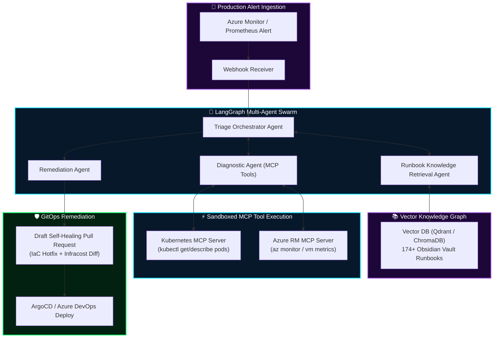

<div align="center">

# 🤖 Agentic AI for DevOps & Autonomous SRE
### Production Blueprints, Model Context Protocol (MCP) & 16-Week Engineering Roadmap

[](https://python.org)
[-00E5FF?style=for-the-badge&logo=anthropic&logoColor=0B0813)](https://modelcontextprotocol.io)
[](https://langchain.com)
[](#-autonomous-incident-response-architecture)

**Architected by [Mihir Maurya](https://github.com/MihirMaurya-dev) · Enterprise Cloud Architect & DevSecOps**

</div>

---

## 🧰 Technology Stack & Tooling

<div align="center">

<a href="https://skillicons.dev">
  
</a>

</div>

<br/>

---

## 🧭 Autonomous Incident Response Architecture

This repository bridges cutting-edge **Agentic AI systems** with real-world **Cloud & DevSecOps infrastructure**. By leveraging Anthropic's **Model Context Protocol (MCP)** and **LangGraph multi-agent swarms**, we automate alert triage, telemetry diagnosis, and self-healing GitOps pull requests.



---

## 🗺️ 16-Week Engineering Roadmap

| Phase | Milestone Focus | Engineering Deliverables |
|:---:|:---|:---|
| **Phase 1** | **Python & LLM Mechanics** | Type hinting, async concurrency, JSON schema parsers, zero-SDK raw API clients, temperature/sampling benchmark harnesses. |
| **Phase 2** | **Tool Calling & MCP Protocol** | MCP server implementation, JSON-RPC protocol transport, sandboxed function calling with schema validation. |
| **Phase 3** | **RAG & Knowledge Graphs** | Vector embeddings, semantic chunking of architectural runbooks, hybrid BM25 + dense vector retrieval via Qdrant. |
| **Phase 4** | **Multi-Agent SRE Swarms** | LangGraph cyclical state machines, ReAct loops, automated incident root cause analysis (RCA), and GitOps self-healing PR generation. |

Detailed week-by-week syllabus available in [`agentic-ai-devops-16-week-roadmap.md`](./agentic-ai-devops-16-week-roadmap.md).

---

## 🛠️ Model Context Protocol (MCP) in Action

Using MCP, agents run in a zero-trust sandbox with granular capabilities rather than arbitrary shell execution:

```json
{
  "name": "inspect_pod_logs",
  "description": "Retrieves container logs from AKS namespace for crash loop diagnosis",
  "inputSchema": {
    "type": "object",
    "properties": {
      "namespace": { "type": "string" },
      "pod_name": { "type": "string" },
      "tail_lines": { "type": "integer", "default": 50 }
    },
    "required": ["namespace", "pod_name"]
  }
}
```

---

<div align="center">

**[Portfolio](https://mihirmaurya-dev.github.io/)** · **[LinkedIn](https://linkedin.com/in/mihirmauryaa1)** · **[DevOps Knowledge Vault](https://github.com/MihirMaurya-dev/DevOps-Notes)**

</div>
